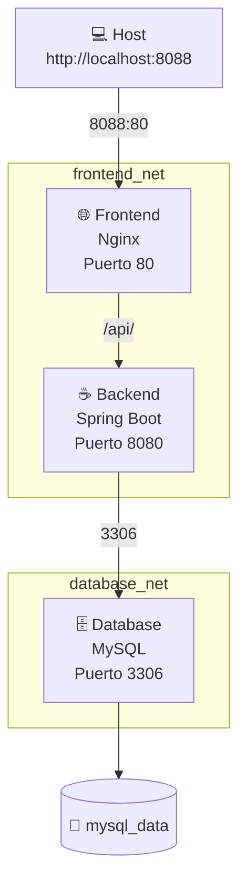

# 🐳 DOCKER DEPLOYMENT LAB – MULTI-STAGE, NETWORKS & MYSQL

---

## 🎯 Objetivos

En este laboratorio deberás:

- Crear imágenes Docker personalizadas
- Utilizar **multi-stage build**
- Incluir una etapa específica para ejecutar tests
- Construir un backend Java Spring Boot
- Construir un frontend con Nginx como reverse proxy
- Utilizar redes Docker definidas por el usuario
- Aislar la base de datos del frontend
- Utilizar volúmenes Docker para persistir los datos
- Desplegar la infraestructura mediante Docker Compose
- Verificar el despliegue utilizando comandos Docker
- Acceder de forma interactiva a contenedores
- Conectar un contenedor a diferentes redes dinámicamente

---

# 🏗️ Arquitectura esperada

La aplicación está formada por tres servicios:

1. **Frontend:** servidor web Nginx
2. **Backend:** aplicación Java Spring Boot
3. **Database:** servidor MySQL

Además, durante las comprobaciones deberás crear un contenedor auxiliar utilizando Alpine.

La arquitectura final será:


### 📊 Topología



---

## 🌐 Redes

Debes crear dos redes:

```text
frontend_net
database_net
```

La distribución debe ser:

```text
frontend
    └── frontend_net

backend
    ├── frontend_net
    └── database_net

database
    └── database_net
```

Por tanto:

- Frontend podrá comunicarse con Backend
- Backend podrá comunicarse con Database
- Frontend y Database no compartirán ninguna red
- Backend será el único servicio conectado a las dos redes

---

# 🧩 PARTE 1 — Backend

Se proporciona el código fuente de una aplicación Java Spring Boot.

No debes modificar el código de la aplicación.

La estructura del proyecto es:

```text
backend/
├── pom.xml
└── src/
    └── ...
```

Para realizar la construcción debes utilizar:

```text
maven:3.9-eclipse-temurin-21
```

Para ejecutar la aplicación debes utilizar:

```text
eclipse-temurin:21-jre
```

---

## 🔨 Stage `build`

Durante la construcción debes trabajar en:

```text
/app
```

Debes disponer dentro de dicho directorio de:

```text
/app/pom.xml
/app/src/
```

Las dependencias del proyecto pueden descargarse mediante:

```bash
mvn dependency:go-offline
```

Para compilar la aplicación debes ejecutar:

```bash
mvn clean package -DskipTests
```

Como resultado de la compilación se generará un archivo `.jar` dentro de:

```text
/app/target/
```

El stage `build` debe encargarse de:

- utilizar la imagen Maven indicada;
- establecer el directorio de trabajo adecuado;
- copiar los archivos necesarios;
- descargar las dependencias;
- compilar la aplicación;
- generar el JAR ejecutable.

---

## 🧪 Stage `test`

Debes crear un stage llamado:

```text
test
```

Este stage debe disponer del código y las dependencias necesarias.

Los tests del proyecto se ejecutan mediante:

```bash
mvn test
```

El stage `test` debe poder construirse de forma independiente para comprobar que los tests terminan correctamente.

---

## 🚀 Stage `runtime`

La imagen final debe utilizar:

```text
eclipse-temurin:21-jre
```

Debes trabajar en:

```text
/app
```

El archivo JAR generado durante la construcción debe quedar disponible como:

```text
/app/app.jar
```

La aplicación se inicia mediante:

```bash
java -jar /app/app.jar
```

La aplicación escucha internamente en el puerto:

```text
8080
```

La imagen final:

- no debe utilizar Maven;
- solo debe contener los elementos necesarios para ejecutar la aplicación;
- debe iniciar automáticamente la aplicación al crear el contenedor.

---

# 🧩 PARTE 2 — Frontend

Se proporcionan los archivos estáticos del frontend dentro de:

```text
frontend/web/
```

Debes utilizar la imagen:

```text
nginx:alpine
```

Nginx sirve por defecto los archivos web almacenados en:

```text
/usr/share/nginx/html/
```

Los archivos proporcionados en:

```text
frontend/web/
```

deben estar disponibles dentro del contenedor en:

```text
/usr/share/nginx/html/
```

---

## ⚙️ Configuración de Nginx

Debes crear el archivo:

```text
frontend/nginx.conf
```

La configuración personalizada deberá almacenarse dentro del contenedor en:

```text
/etc/nginx/conf.d/default.conf
```

Nginx debe:

- escuchar en el puerto `80`;
- servir los archivos estáticos del frontend;
- actuar como reverse proxy;
- redirigir las peticiones realizadas a `/api/` hacia el backend.

El backend estará accesible mediante:

```text
backend:8080
```

No debes utilizar direcciones IP fijas.

---

# 🧩 PARTE 3 — Base de datos

Debes utilizar la imagen:

```text
mysql:8.4
```

La base de datos utilizará la siguiente configuración (variables de entorno):

```text
Base de datos: taskmanager
Usuario: taskuser
Contraseña: taskpass
Contraseña root: rootpass
```

MySQL almacena sus datos en:

```text
/var/lib/mysql
```

Debes utilizar un volumen Docker para mantener persistente el contenido de dicho directorio.

MySQL escucha internamente en:

```text
3306
```

Este puerto **no debe publicarse en el host**.

---

## 🔗 Conexión del backend

La aplicación backend necesita los siguientes datos para conectarse a MySQL:

```text
Servidor: database
Puerto: 3306
Base de datos: taskmanager
Usuario: taskuser
Contraseña: taskpass
```

Las variables de entorno utilizadas por la aplicación son:

```text
DB_HOST
DB_PORT
DB_NAME
DB_USER
DB_PASSWORD
```

Debes configurarlas durante el despliegue.

---

# 🧩 PARTE 4 — docker-compose.yaml

Debes crear un archivo:

```text
docker-compose.yaml
```

Debe definir los siguientes servicios:

```text
frontend
backend
database
```

---

## Frontend

Debe:

- construir su imagen a partir del Dockerfile correspondiente;
- pertenecer únicamente a `frontend_net`;
- publicar su puerto interno `80` en el puerto `8088` del host.

La aplicación deberá estar disponible en:

```text
http://localhost:8088
```

---

## Backend

Debe:

- construir su imagen a partir del Dockerfile correspondiente;
- utilizar el stage final de ejecución;
- pertenecer a `frontend_net`;
- pertenecer también a `database_net`;
- recibir mediante variables de entorno los datos necesarios para conectarse a MySQL;
- no publicar su puerto en el host.

---

## Database

Debe:

- utilizar la imagen oficial indicada;
- configurar MySQL mediante variables de entorno;
- utilizar un volumen Docker;
- pertenecer únicamente a `database_net`;
- no publicar su puerto en el host.

---

## Condiciones obligatorias

La infraestructura debe cumplir:

```text
frontend  → backend     PERMITIDO

backend   → database    PERMITIDO

frontend  → database    NO PERMITIDO
```

Además:

- únicamente frontend debe publicar un puerto hacia el host;
- no deben utilizarse direcciones IP fijas;
- la comunicación entre servicios debe realizarse mediante nombres de servicio;
- backend debe pertenecer simultáneamente a las dos redes.

---

# 🧩 PARTE 5 — Despliegue

Construye y despliega la infraestructura completa mediante Docker Compose.

Una vez iniciada, comprueba que puedes acceder a:

```text
http://localhost:8088
```

La aplicación deberá mostrar correctamente la información obtenida mediante el backend y la base de datos.

---

# 🧩 PARTE 6 — Verificaciones

Debes realizar comprobaciones utilizando comandos Docker.

No se indican los comandos concretos que debes utilizar. Debes seleccionar en cada caso el comando adecuado.

---

## 📦 Contenedores

Demuestra:

- que los tres servicios están en ejecución;
- el estado actual de los contenedores;
- qué puertos publica cada contenedor.

Debe quedar demostrado que:

- frontend publica el puerto `8088`;
- backend no publica ningún puerto;
- database no publica ningún puerto.

---

## 🌐 Redes

Identifica las redes Docker creadas.

Demuestra qué contenedores están conectados a cada una.

El resultado debe corresponder a:

```text
frontend_net
├── frontend
└── backend
```

```text
database_net
├── backend
└── database
```

También debes demostrar que backend está conectado simultáneamente a las dos redes.

---

## 🔎 Inspección

Utiliza comandos Docker para obtener información de los contenedores desplegados.

Debes demostrar al menos:

- las redes a las que pertenece backend;
- los puertos publicados por frontend;
- la configuración de red de database;
- el volumen utilizado por MySQL.

---

# 🧩 PARTE 7 — Pruebas de conectividad

Realiza pruebas de conectividad entre los servicios.

Puedes acceder de forma interactiva a los contenedores cuando sea necesario.

Debes realizar al menos las siguientes comprobaciones:

### Frontend → Backend

Debe existir conectividad.

### Backend → Database

Debe existir conectividad.

### Frontend → Database

No debe existir conectividad directa.

Utiliza `ping` cuando sea necesario.

Incluye en el documento de evidencias:

- al menos una prueba de conectividad correcta;
- al menos una prueba de conectividad fallida;
- una breve explicación del resultado obtenido.

---

# 🧩 PARTE 8 — Verificación del multi-stage

Debes construir explícitamente el stage:

```text
test
```

del Dockerfile del backend.

Debes demostrar que:

- el stage puede construirse de forma independiente;
- los tests finalizan correctamente.

También debes construir la imagen final del backend y comprobar que puede utilizarse para ejecutar la aplicación.

---

# 🧩 PARTE 9 — Volúmenes

Comprueba mediante comandos Docker:

- que existe el volumen utilizado por MySQL;
- que dicho volumen está asociado al contenedor de base de datos.

Debes incluir una evidencia de esta comprobación.

---

# 🧩 PARTE 10 — Contenedor auxiliar

Para esta parte debes utilizar:

```text
alpine:latest
```

El contenedor auxiliar **no debe formar parte del archivo `docker-compose.yaml`**.

Debes crear manualmente un contenedor llamado:

```text
docker-tools
```

El contenedor deberá permanecer en ejecución para poder realizar las comprobaciones.

---

## Primera conexión

Conecta `docker-tools` a:

```text
frontend_net
```

Accede de forma interactiva al contenedor.

Realiza pruebas de conectividad con los servicios accesibles desde dicha red.

---

## Segunda conexión

Sin eliminar ni volver a crear `docker-tools`, conéctalo también a:

```text
database_net
```

Después:

- comprueba las redes a las que pertenece;
- realiza una prueba de conectividad con el servicio de base de datos.

El contenedor deberá terminar conectado simultáneamente a:

```text
frontend_net
database_net
```

Debes utilizar comandos Docker para realizar todas las operaciones.

---

# 📄 Documento de evidencias

Debes entregar un documento PDF que incluya las principales evidencias del trabajo realizado.

No es necesario incluir capturas de todos los comandos ejecutados.

El documento debe mostrar, al menos:

- construcción correcta del stage `test`;
- resultado de los tests;
- contenedores desplegados;
- aplicación funcionando desde el navegador;
- puertos publicados;
- redes Docker creadas;
- contenedores pertenecientes a cada red;
- backend conectado a dos redes;
- una prueba de conectividad correcta;
- una prueba de aislamiento;
- volumen utilizado por MySQL;
- creación del contenedor `docker-tools`;
- conexión dinámica de `docker-tools` a las redes;
- breve explicación de las verificaciones realizadas.

Las capturas deben ser legibles y permitir identificar el comando ejecutado y su resultado cuando sea necesario.

---

# 📌 Entregables

Debes entregar el proyecto completo.

La estructura final será similar a:

```text
dockerlabexam_26_27/
├── README.md
├── docker-compose.yaml
├── .gitignore
│
├── backend/
│   ├── Dockerfile
│   ├── pom.xml
│   └── src/
│       ├── main/
│       │   ├── java/
│       │   └── resources/
│       └── test/
│           └── java/
│
└── frontend/
    ├── Dockerfile
    ├── nginx.conf
    └── web/
        └── index.html
```

---

# ⚠️ Consideraciones

- No debes modificar el código fuente proporcionado.
- No debes utilizar direcciones IP fijas para comunicar contenedores.
- Utiliza los nombres de los servicios Docker.
- No publiques puertos que no sean necesarios.
- El backend deberá pertenecer a las dos redes.
- Frontend y Database no deben compartir ninguna red.
- El contenedor `docker-tools` debe crearse manualmente y no mediante Docker Compose.
- Las comprobaciones deben realizarse utilizando Docker y las herramientas indicadas.
- Se valorará tanto el funcionamiento del despliegue como las evidencias aportadas.

---

## ✅ Resultado esperado

Al finalizar la actividad debes disponer de:

- una imagen personalizada para el backend;
- una imagen personalizada para el frontend;
- un backend construido mediante multi-stage;
- un stage independiente para tests;
- una base de datos MySQL persistente;
- dos redes Docker;
- un backend conectado simultáneamente a ambas redes;
- un frontend accesible desde el host;
- una base de datos aislada del frontend;
- un contenedor auxiliar conectado dinámicamente a las redes;
- evidencias que permitan comprobar el correcto funcionamiento de la infraestructura.